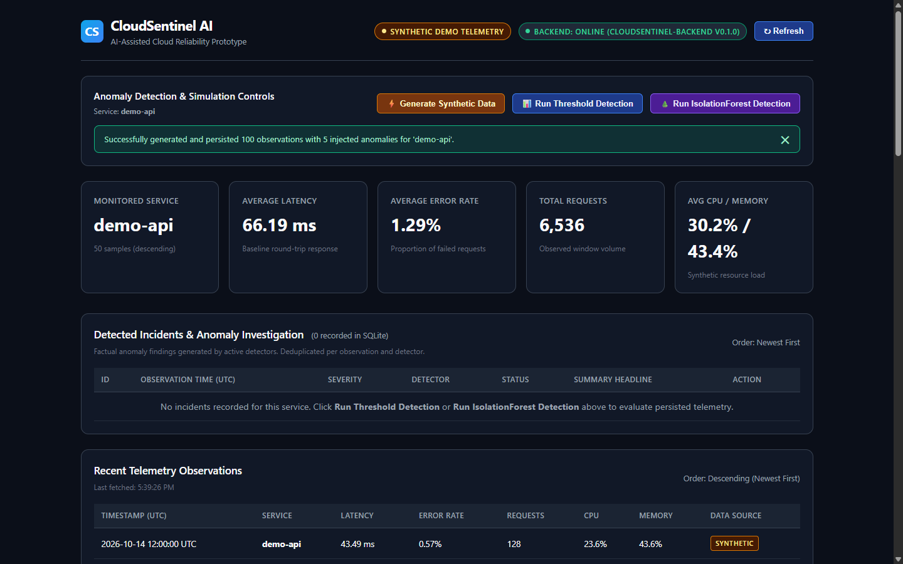
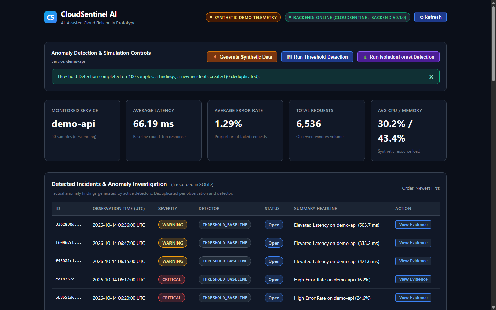
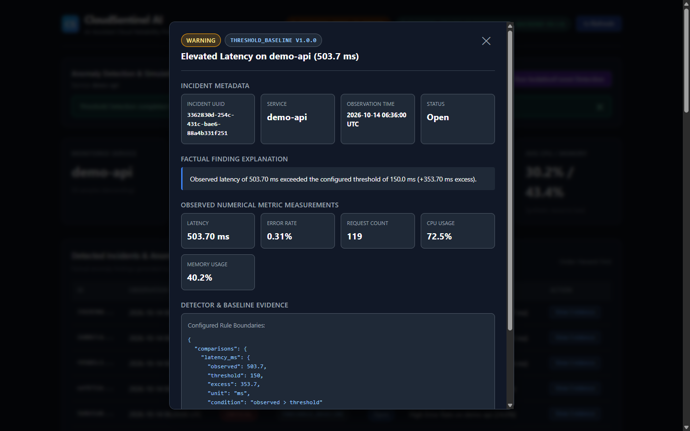
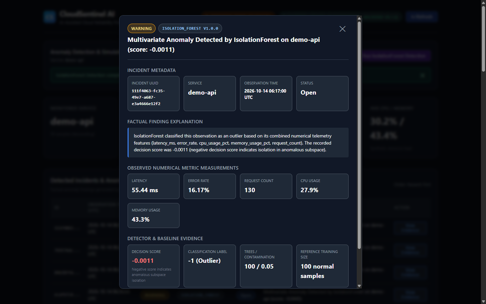
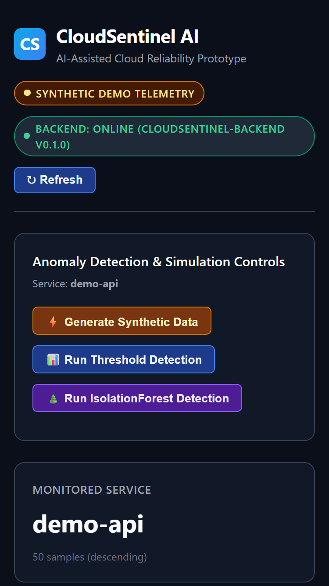
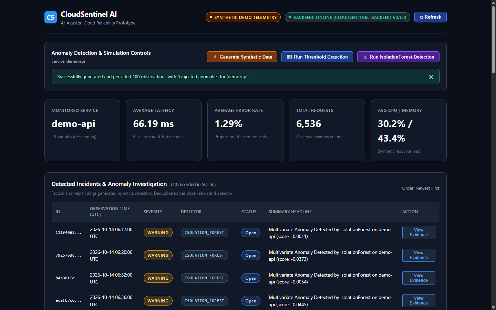

# CloudSentinel AI

[](https://github.com/ARKkhanz/cloudsentinel-ai/actions/workflows/ci.yml)
[](https://www.python.org/)
[](https://react.dev/)
[](https://fastapi.tiangolo.com/)
[](https://scikit-learn.org/)
[](https://docs.docker.com/compose/)

> **An evidence-backed reliability engineering prototype that ingests synthetic cloud service telemetry, detects operational anomalies via transparent threshold rules and multivariate IsolationForest machine learning, deduplicates alert incidents via cryptographic fingerprinting, and provides factual numerical evidence for developer investigation.**

Developed as a four-day engineering project following the *CloudSentinel AI Implementation & Learning Blueprint*.

---


---

## Executive Summary

Modern cloud infrastructure produces high-velocity telemetry (latency, error rates, resource utilization). Detecting and triaging operational anomalies usually presents two severe engineering challenges:
1. **Alert Fatigue**: Naive detection rules spam on-call engineers with duplicate alerts for ongoing degradation.
2. **Opaque "Black Box" Warnings**: Anomaly alerts often fail to explain *why* an observation was flagged, leaving developers without verifiable evidence.

**CloudSentinel AI** demonstrates an end-to-end, reproducible solution to both problems:
- **Dual Detection Paradigms**: A deterministic **Threshold Baseline Detector** (`latency_ms > 150.0`, `error_rate > 0.05`) and an unsupervised **IsolationForest Machine Learning Detector** (evaluating 5 multivariate features).
- **Factual Evidence Chains**: Every created incident preserves an immutable snapshot of observed telemetry measurements alongside explicit mathematical boundaries (threshold excess or decision path score).
- **Canonical SHA-256 Deduplication**: Incidents compute a deterministic SHA-256 fingerprint over the service, detector configuration, observation timestamp, and canonicalized numerical measurements, guaranteeing that repeat detection passes create **zero duplicate alerts**.
- **Production Architecture**: A responsive React 18 + TypeScript single-page application served either standalone via Vite or containerized behind an unprivileged Nginx reverse proxy concealing internal Docker networks.

---

## Key Implemented Features

- **Synthetic Telemetry Generation**: Seeded, deterministic generation (`Seed 42`) producing sine-wave baseline traffic with Gaussian noise and 5 controlled anomaly injections (3 latency spikes, 2 error surges).
- **Dual Anomaly Detection**:
  - *Statistical Threshold*: $O(1)$ deterministic evaluation capturing univariate spikes exceeding statistical baselines ($z > 21$ on latency, $z > 22$ on error rate).
  - *IsolationForest (Scikit-Learn)*: Unsupervised multivariate tree isolation across 5 numerical dimensions (`latency_ms`, `error_rate`, `cpu_usage_pct`, `memory_usage_pct`, `request_count`).
- **Forensic Investigation Modal**: Interactive UI dialog displaying observed measurements, threshold breach deltas, tree isolation decision scores, and model parameters.
- **Deduplication Engine**: Unique `dedup_key` constraint in SQLite preventing redundant alerts across repeated detector runs.
- **ACID Persistence**: SQLite storage engine via SQLAlchemy 2.x ORM with write-ahead logging (WAL) and automatic table initialization.
- **Frontend Resilience**: Automatic detection of backend disconnection, displaying a stale cached telemetry warning and retry button without locking the UI.
- **Multi-Container Docker Deployment**: Production-ready Nginx reverse proxy routing traffic to an internal FastAPI ASGI container with non-root security privileges and persistent SQLite named volumes.
- **Automated CI Quality Gates**: Three-job GitHub Actions pipeline testing backend unit tests, ML benchmarks, frontend lint/build, and live multi-container Docker persistence.

---

## Verified Technology Stack

| Layer | Technology | Purpose |
| :--- | :--- | :--- |
| **Frontend UI** | React 18 + TypeScript + Vite | Reactive single-page application, action controls toolbar, KPI summary cards, telemetry table, and incident evidence modal |
| **Styling** | Vanilla CSS (Dark Mode) | Glassmorphic design, responsive flexbox/grid layout, CSS variables, zero runtime CSS overhead |
| **Backend API** | Python 3.11 + FastAPI + Uvicorn | High-performance ASGI web service, route handlers, CORS middleware, and detection pipelines |
| **Machine Learning** | Scikit-Learn 1.5.2 + NumPy | Unsupervised multivariate IsolationForest anomaly detection with reproducible random seeds |
| **Validation** | Pydantic v2 | Strict request validation, response serialization, and timestamp normalization |
| **Persistence** | SQLite + SQLAlchemy 2.x ORM | ACID persistence for metric samples and deduplicated incident evidence snapshots |
| **Web Server / Proxy** | Nginx (Alpine) | Production reverse proxy serving static SPA bundles and proxying `/api/` and `/health` |
| **Containerization** | Docker + Docker Compose v2 | Multi-container orchestration, non-root system users, internal bridge network, and named volumes |
| **Testing** | pytest + TestClient + Chrome CDP | 114 backend tests (100% pass) + 13-check automated Google Chrome browser QA test suite |
| **Continuous Integration** | GitHub Actions (`ubuntu-24.04`) | Automated multi-job workflow verifying code quality, Docker containers, and persistence |

---

## System Architecture

```text
[Synthetic Telemetry Generator]
       │ (100 samples, 5 injected spikes: Seed 42)
       ▼
[SQLite Storage Engine: metric_samples]
       │
       ▼
[Incident Service Layer]
   ├──> Threshold Baseline Detector (latency_ms > 150.0ms, error_rate > 0.05)
   └──> IsolationForest ML Detector (5 features: latency, error, cpu, mem, requests)
       │
       ▼
[Deterministic SHA-256 Deduplication]
       │ (Fingerprint: service:detector:sha256[:32] -> dedup_key)
       ▼
[SQLite Storage Engine: incidents]
       │ (Stores immutable evidence snapshots)
       ▼
[FastAPI REST API / Uvicorn :8000]
       │ GET  /health              -> Application process responsiveness check
       │ GET  /api/metrics         -> Query persisted telemetry observations
       │ POST /api/demo/generate   -> Seed synthetic telemetry with injected anomalies
       │ POST /api/detection/run   -> Trigger detection pipeline & generate incidents
       │ GET  /api/incidents       -> Retrieve persisted incident records (newest first)
       │ GET  /api/incidents/{id}  -> Retrieve full evidence payload for specific incident
       ▼
[Nginx Reverse Proxy / Vite Server]
       │ (Port 3000 in Docker / Port 5173 in Dev)
       ▼
[React 18 TypeScript Dashboard]
```

> [!TIP]
> Complete architectural diagrams (Application Data Flow, Multi-Container Docker Network, and CI Pipeline) are documented in [`docs/architecture.md`](docs/architecture.md).

---

## Visual Evidence & Investigation Gallery

The following genuine screenshots demonstrate the end-to-end user workflow captured during automated browser testing:

| Feature / Workflow | Visual Evidence | Key Details |
| :--- | :---: | :--- |
| **1. Telemetry & KPI Cards** |  | 100 observations generated, 50 rows displayed in UI table (display limit), calculated KPI averages. |
| **2. Threshold Detection** |  | 5 `THRESHOLD_BASELINE` incidents generated with `WARNING` and `CRITICAL` severity badges. |
| **3. Threshold Evidence Modal** |  | Factual comparison of observed metric readings against configured threshold boundaries (`latency_ms > 150.0`, `error_rate > 0.05`). |
| **4. IsolationForest ML Incidents** |  | 10 total incidents showing both threshold rules and multivariate IsolationForest findings. |
| **5. ML Evidence Modal** |  | Raw Scikit-Learn decision score (e.g. `-0.0011`), model hyperparameters (`100` trees, `0.05` contamination), and feature space. |
| **6. Mobile Responsiveness** |  | 375×667 mobile viewport layout showing stacked controls and zero horizontal overflow. |
| **7. Resilient Outage Recovery** |  | Stale cached data warning banner displayed upon network drop, clearing cleanly upon reconnect. |

---

## Detection Methodology & Evaluation Benchmark

### Detection Algorithms
1. **Threshold Baseline Detector (`threshold_baseline`)**:
   - Evaluates samples against configurable statistical boundaries.
   - Defaults: `latency_ms > 150.0ms` (normal $\mu=42\text{ms}, \sigma=5\text{ms}$; $z > 21$) and `error_rate > 0.05` (normal $\mu=0.5\%, \sigma=0.2\%$; $z > 22$).
   - Characteristics: $O(1)$ execution time, deterministic, completely explainable.
2. **IsolationForest Multivariate Detector (`isolation_forest`)**:
   - Fits an ensemble of 100 isolation trees over reference normal telemetry.
   - Evaluates **5 canonical numerical dimensions**: `latency_ms`, `error_rate`, `cpu_usage_pct`, `memory_usage_pct`, `request_count`.
   - Characteristics: Unsupervised, detects multi-variable correlation anomalies without manual thresholds.

### Benchmark Evaluation (Canonical Synthetic Dataset)
Executed via `backend/scripts/evaluate_detectors.py` (Evaluation set: 100 samples, 5 injected anomalies):

| Metric | Threshold Baseline | IsolationForest |
| :--- | :---: | :---: |
| **Precision** | **1.0000** (100.0%) | **0.8000** (80.0%) |
| **Recall** | **1.0000** (100.0%) | **0.8000** (80.0%) |
| **F1-Score** | **1.0000** | **0.8000** |
| **False-Positive Rate (FPR)** | **0.0000** (0.00%) | **0.0105** (1.05%) |
| **Confusion Matrix** | `[[TN=95, FP=0], [FN=0, TP=5]]` | `[[TN=94, FP=1], [FN=1, TP=4]]` |

> [!NOTE]
> **Scientific Scope Note**: The 1.0 F1 score achieved by the threshold detector is an artifact of synthetic injection magnitudes exceeding static boundaries by design. The benchmark demonstrates detector execution and evaluation math; real-world production environments involve complex multi-variable drift and non-linear patterns.

---

## Quick Start & Reproduction

### Option A: Local Development Setup (~3 Minutes if prerequisites installed)

#### 1. Clone & Set Up Backend
```bash
git clone https://github.com/ARKkhanz/cloudsentinel-ai.git
cd cloudsentinel-ai

# Windows (PowerShell):
python -m venv backend/.venv
.\backend\.venv\Scripts\activate
pip install -r backend/requirements.txt
python -m uvicorn backend.app.main:app --host 127.0.0.1 --port 8000

# Linux / macOS (bash):
python3 -m venv backend/.venv
source backend/.venv/bin/activate
pip install -r backend/requirements.txt
python -m uvicorn backend.app.main:app --host 127.0.0.1 --port 8000
```

#### 2. Set Up Frontend (In a second terminal)
```bash
cd frontend
npm ci
npm run dev -- --host 127.0.0.1 --port 5173
```
Open [`http://127.0.0.1:5173`](http://127.0.0.1:5173) in your browser.

---

### Option B: Multi-Container Docker Compose Stack

If Docker and Docker Compose are installed:
```bash
# Build images and start containers:
docker compose up --build -d

# Verify running services:
docker compose ps

# Access application:
# React Dashboard (via Nginx proxy): http://localhost:3000
# Backend Health Probe:              http://localhost:3000/health
# OpenAPI / Swagger Docs:            http://localhost:8000/docs

# Safe teardown preserving SQLite data volume:
docker compose down
```

> [!WARNING]
> Always run `docker compose down` (WITHOUT `-v`). The `-v` flag deletes the named storage volume (`cloudsentinel-data`), destroying all persisted telemetry and incidents.

> [!TIP]
> Complete walkthroughs for technical evaluators are documented in [`docs/evaluator-guide.md`](docs/evaluator-guide.md).

---

## Automated Quality & Verification Suite

All quality checks are executable from the repository root:

```bash
# 1. Full Backend Pytest Suite (114 tests):
.\backend\.venv\Scripts\python.exe -m pytest -v

# 2. Frontend ESLint 10 Check:
cd frontend && npm run lint && cd ..

# 3. Frontend TypeScript & Vite Production Build:
cd frontend && npm run build && cd ..

# 4. Reproducible ML Benchmark Evaluation:
.\backend\.venv\Scripts\python.exe backend/scripts/evaluate_detectors.py

# 5. Real Google Chrome DevTools Protocol (CDP) Automated Browser QA:
# (Ensure backend was started with isolated DATABASE_URL and frontend is on :5173)
.\backend\.venv\Scripts\python.exe backend/tests/day4_milestone1_browser_qa.py
```
- **Backend Test Status**: `114 passed, 0 failed` in ~13.8s across all 8 test modules.
- **Frontend Lint Status**: `0 errors, 0 warnings`.
- **Frontend Build Status**: Compiled in ~970ms (`dist/index.html 0.75 kB`, `assets/*.css 9.14 kB`, `assets/*.js 163.55 kB`).
- **Browser QA Status**: `13/13 PASSED (100%)` in real Google Chrome headless CDP.

---

## Continuous Integration (GitHub Actions)

CloudSentinel AI runs an automated, multi-job continuous integration pipeline pinned to stable LTS GitHub-hosted `ubuntu-24.04` runners:

* **Workflow Definition**: [`.github/workflows/ci.yml`](.github/workflows/ci.yml)
* **Runner Environment**: `ubuntu-24.04`
* **Verified CI Workflow Run**: [Run #38737264452 (100% Green, Zero Warnings)](https://github.com/ARKkhanz/cloudsentinel-ai/actions/runs/38737264452)

### CI Jobs
1. **`Frontend Lint & Production Build`** (Node.js 24, `npm ci`, ESLint 10, Vite build): Pass (14s)
2. **`Backend Unit Tests & ML Evaluation`** (Python 3.11, 114 pytest tests, `evaluate_detectors.py` benchmark): Pass (41s)
3. **`Docker Compose Integration & Persistence`** (Multi-container build, health probes, synthetic generation, dual detection, deduplication, SQLite named volume persistence): Pass (1m 0s)

---

## Security, Scientific Truthfulness & Limitations

To maintain strict scientific and engineering rigor, CloudSentinel AI adheres to these documented boundaries:
1. **Synthetic Telemetry Scope**: All metric observations are synthetically generated using mathematical distributions to model latency spikes and error surges deterministically. It is not live production traffic.
2. **Ground Truth Isolation**: Synthetic injection labels (`is_anomaly=True`) are isolated exclusively for post-detection scoring and are never fed into detector feature vectors.
3. **No Root-Cause Fabrication**: The prototype surfaces factual mathematical evidence (breached thresholds and decision scores). It does **NOT** diagnose or fabricate narrative root causes (e.g. claiming a memory leak or database deadlock).
4. **Unsupervised ML Score Meaning**: Negative IsolationForest anomaly scores indicate tree traversal isolation depth, **NOT** calibrated failure probabilities.
5. **No Destructive Auto-Remediation**: CloudSentinel AI is an observability and decision-support prototype. It does not execute automated restarts or infrastructure mutations.
6. **No Future Outage Forecasting**: Detectors identify statistical deviations in observed telemetry; they do not forecast future failure timestamps.
7. **Security Hygiene**: Container definitions use unprivileged users (`cloudsentinel` UID 10001, `nginx`), specific pinned base images, explicit CORS policies, and zero committed credentials.

---

## Project Roadmap

- **Day 1: Skeleton + Real API + Connected Dashboard**
  - [x] **Milestone 0**: Repository & GitHub setup (`main` branch, `.gitignore`, `.env.example`, initial structure)
  - [x] **Milestone 1**: Minimal FastAPI backend + deterministic synthetic metric generator
  - [x] **Milestone 2**: Automated backend test suite with `pytest` (17 tests, 100% pass)
  - [x] **Milestone 3**: React + TypeScript + Vite frontend skeleton and centralized API client
  - [x] **Milestone 4**: Connected React dashboard displaying real FastAPI data, error banners, and stale state handling
  - [x] **Milestone 5**: Full test suite verification, build checks, and comprehensive documentation
- **Day 2: Persistence, Anomaly Detection & Incident Workflow**
  - [x] **Milestone 1**: SQLite database persistence with SQLAlchemy 2.x ORM models (`MetricSampleModel`, `IncidentModel`)
  - [x] **Milestone 2**: Reproducible synthetic anomaly generator with controlled latency spikes and error surges
  - [x] **Milestone 3**: Transparent threshold baseline anomaly detector (`ThresholdDetector`)
  - [x] **Milestone 4**: Multivariate `IsolationForest` anomaly detector with Scikit-Learn
  - [x] **Milestone 5**: Incident generation, evidence preservation, deduplication, FastAPI APIs, and React dashboard integration
  - [x] **Milestone 6**: Reproducible ML evaluation, reliability hardening (schema migration logging & SHA-256 fingerprint deduplication), comprehensive documentation, and final Day 2 verification
- **Day 3: Quality, Docker & GitHub Actions CI**
  - [x] **Milestone 1**: Engineering quality, dependency hygiene, ESLint 10, and security review
  - [x] **Milestone 2**: Secure backend and frontend Dockerfiles + production Nginx configuration
  - [x] **Milestone 3**: Docker Compose multi-container orchestration, networking, and SQLite volume persistence
  - [x] **Milestone 4**: GitHub Actions CI workflow + real Docker multi-container integration and SQLite persistence verification
  - [x] **Milestone 5**: Final Day 3 quality gate, CI hardening, and comprehensive documentation
- **Day 4: Final Verification, Presentation & Portfolio Delivery**
  - [x] **Milestone 1**: Final end-to-end evaluator verification journey (3-min demo & fresh reproduction guides, real Google Chrome CDP automation, 13/13 QA checks, database isolation)
  - [x] **Milestone 2**: Professional portfolio presentation, architecture diagrams (`docs/architecture.md`), visual evidence gallery, and documentation polish
  - [ ] **Milestone 3**: Final portfolio delivery, interview talking points, and blueprint acceptance signoff *(Planned)*

---

## Documentation Directory

- **[Technical Architecture & Diagrams](docs/architecture.md)**: Detailed Mermaid diagrams for application data flow, Docker networking, and CI automation.
- **[Evaluator Verification Guide](docs/evaluator-guide.md)**: Plain-English reproduction manual detailing the 3-minute quick demo and fresh clean-machine setup.
- **[Day 4 End-to-End QA Report](docs/day4_milestone1_qa_report.md)**: Chrome CDP test execution report, negative test proofs, and assertions audit.
- **[ML Experiment Results](docs/experiment-results.md)**: Confusion matrices, mathematical derivation of metrics, and detector comparison analysis.
- **[Engineering Learning Notes](docs/learning-notes.md)**: Deep dive into architectural tradeoffs, deduplication mechanics, and reliability patterns.
- **[Container Orchestration Guide](docs/milestone-3-orchestration.md)**: Docker Compose specifications, volume persistence, and networking topology.
