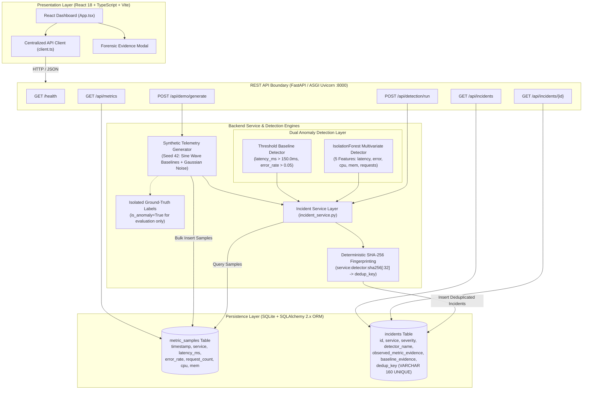
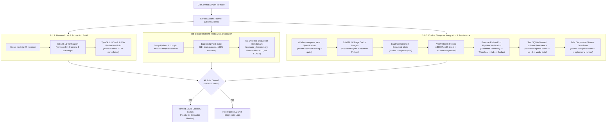

# CloudSentinel AI — System Architecture & Engineering Specifications

> **Technical architecture reference for CloudSentinel AI, illustrating the end-to-end telemetry ingestion pipeline, dual anomaly detection engines, multi-container Docker deployment, and GitHub Actions continuous integration quality gates.**

---

## 1. Architectural Overview & Design Principles

CloudSentinel AI is an evidence-backed reliability engineering prototype designed around four core principles:

1. **Separation of Concerns**: Ingestion, detection, deduplication, and presentation are strictly decoupled. Detection engines operate solely on numerical metric vectors and never access synthetic ground-truth labels.
2. **Transparent Mathematical Evidence**: Anomaly findings do not fabricate speculative root-cause narratives. Incidents preserve immutable snapshots of measured telemetry values alongside explicit algorithmic boundaries (threshold breaches or tree isolation scores).
3. **Alert Fatigue Prevention via Cryptographic Deduplication**: Incidents compute a deterministic SHA-256 fingerprint over the service name, detector identity, configuration summary, observation timestamp, and canonicalized numerical metrics. Repeated detector runs over identical observations generate **zero duplicate incidents**.
4. **Reproducibility & Infrastructure Parity**: The system is fully reproducible locally via Python virtual environments / Vite dev servers, in containerized environments via Docker Compose, and continuously verified on GitHub Actions runners.

---

## 2. Diagram A: Application Architecture & Telemetry Pipeline

The diagram below details the data flow from synthetic generation and persistence through the dual detection engines, deduplication service, and interactive React dashboard.



---

## 3. Diagram B: Multi-Container Docker Architecture

The diagram below illustrates the production container deployment orchestrated via `compose.yaml`, featuring reverse-proxy routing, internal bridge networking, non-root security privileges, and persistent volume storage.

```mermaid
flowchart LR
    User["Web Browser\n(Evaluator / Developer)"]

    subgraph DockerHost["Docker Host Environment (compose.yaml)"]
        subgraph FrontendContainer["Frontend Container (cloudsentinel-frontend)"]
            Nginx["Production Nginx Web Server (:80)\nNon-root user 'nginx'"]
            Dist["Pre-compiled Static SPA Assets\n(/usr/share/nginx/html)"]
            Nginx --- Dist
        end

        subgraph BridgeNet["Internal Docker Network (cloudsentinel-net)"]
            ProxyPass["Nginx Reverse Proxy Pass\nlocation /api/ -> backend:8000\nlocation /health -> backend:8000"]
        end

        subgraph BackendContainer["Backend Container (cloudsentinel-backend)"]
            Uvicorn["FastAPI ASGI Uvicorn (:8000)\nNon-root user 'cloudsentinel' (UID 10001)"]
            AppCode["Application Code (/app/backend)"]
            SQLAlchemy["SQLAlchemy 2.x Session Engine"]
            Uvicorn --- AppCode
            AppCode --- SQLAlchemy
        end

        subgraph VolumeStorage["Persistent Volume Storage"]
            NamedVol[("Named Storage Volume\n(cloudsentinel-data)\nMounted at /app/data\nSQLite: cloudsentinel.db")]
        end
    end

    User -->|HTTP :3000| Nginx
    Nginx --> ProxyPass
    ProxyPass -->|HTTP :8000 (Internal DNS)| Uvicorn
    SQLAlchemy -->|Read / Write ACID| NamedVol
```

---

## 4. Diagram C: Continuous Integration Pipeline (GitHub Actions)

The diagram below outlines the automated verification pipeline defined in [`.github/workflows/ci.yml`](../.github/workflows/ci.yml), executing on GitHub-hosted `ubuntu-24.04` runners across all pull requests and pushes to `main`.



---

## 5. Technical Contracts & Implementation Summary

| Component | Specification / Contract | Source File |
| :--- | :--- | :--- |
| **Telemetry Format** | Pydantic `MetricSample` (`timestamp`, `service`, `latency_ms`, `error_rate`, `request_count`, `cpu_usage_pct`, `memory_usage_pct`) | [`backend/app/schemas/metrics.py`](../backend/app/schemas/metrics.py) |
| **Threshold Rules** | `latency_ms > 150.0` (z > 21 baseline) and `error_rate > 0.05` (z > 22 baseline) | [`backend/app/detection/threshold_detector.py`](../backend/app/detection/threshold_detector.py) |
| **IsolationForest Features** | 5 fixed features: `latency_ms`, `error_rate`, `cpu_usage_pct`, `memory_usage_pct`, `request_count` | [`backend/app/detection/isolation_forest_detector.py`](../backend/app/detection/isolation_forest_detector.py) |
| **Deduplication Key** | `service:detector:sha256[:32]` stored in `dedup_key` (VARCHAR 160 UNIQUE) | [`backend/app/services/incident_service.py`](../backend/app/services/incident_service.py) |
| **API Endpoints** | `/health`, `/api/metrics`, `/api/demo/generate`, `/api/detection/run`, `/api/incidents`, `/api/incidents/{id}` | [`backend/app/main.py`](../backend/app/main.py) |
| **Database Schema** | SQLite with SQLAlchemy ORM (`metric_samples`, `incidents`), WAL mode, auto-schema migration | [`backend/app/models/`](../backend/app/models/) |
| **Container Networking** | Internal bridge `cloudsentinel-net`, Nginx reverse proxy on port 3000, Uvicorn on port 8000 | [`compose.yaml`](../compose.yaml) |
| **CI Automation** | Multi-job workflow on `ubuntu-24.04`, Python 3.11, Node 24, real Docker integration | [`.github/workflows/ci.yml`](../.github/workflows/ci.yml) |
